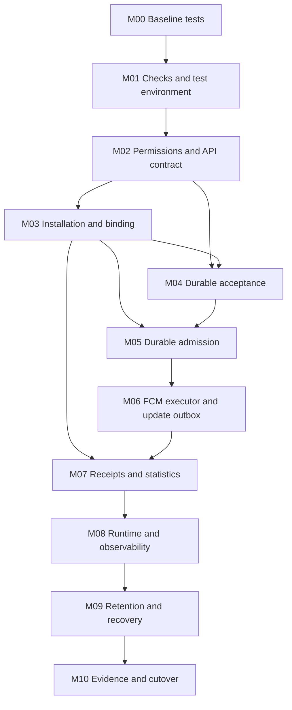

# Backend implementation milestones

Date: 2026-11-02. Status: work sequence, not evidence of implementation/production readiness.
Index: [production plan](production-readiness-plan.md).
Shared rules: [CR1–CR9 and gates G1–G7](adr-01-11-consistency-review.md).

## Sequence and dependencies

Step numbers 01–46 still follow the production plan; these milestones group
work by dependency and do not require all security work to wait for the pipeline.
M00 was completed on 2026-11-02: mocks were regenerated, tests were aligned, and all unit
tests and the build passed. M01 step 18 is complete as CI configuration/local checks;
a hosted run has not been observed. Step 19 dependency environment/smoke is also complete
locally; M01 is complete within that evidence boundary, not as hosted integration or
pipeline acceptance. M02–M10 are not yet
complete. Work that uses
unsettled decisions must record the proposed/test-only boundary in its SPEC;
it must not be enabled in production with hidden assumptions.

| Milestone | Dependencies | Sequential work slices and outputs | Completion criteria | Related steps |
| --- | --- | --- | --- | --- |
| M00 Baseline tests | No external gate | Regenerate mocks from interfaces; fix staff fixtures/assertions for actor/password guards; fix segment search/batch count assertions | Build and all unit tests pass without skips/weakened guards; failure-path tests reflect the current contract | 17 |
| M01 Checks and test environment | M00 | Separate CI format/build/test/vet/vulnerability commits; then test PostgreSQL/migrations, Kafka topics, and an isolated simulated provider | Checks are repeatable from a clean checkout; deterministic readiness/cleanup; no sends to real devices or reads of production credentials | 18,19 |
| M02 API permissions and contract baseline | M01; G5 decisions used by this milestone | SPEC for the permission matrix and compatibility first; deny-by-default mutations including scheduling; safe errors/body limits/audit; documentation for changed APIs | VIEWER cannot mutate/send/schedule through either handlers or services; inactive actors/forged access are rejected; public DTOs/errors do not leak information | 20,31–33 |
| M03 Application scope and immutable installation/binding | M02 baseline; ADR-12; G3/G5 for enrollment | M03a registry/principals/grants; M03b scoped schema/queries/APIs and legacy bridge gate; M03c installation/proof/JWT/binding; M03d generic mobile lifecycle/receipt contract. See the [plan](../specs/m03a-application-scope-plan.md). | A/B isolation and legacy route gate before the second app; refresh/transfer/revocation races preserve immutable app/owner; generic client contract and per-app gates | 20,22,30,32,33 |
| M04 Durable acceptance | M01,M02; shared M03 schema/event contract | Combined acceptance/admission SPEC defines deadlines, epochs, and lock order; atomic key+claim+audit+send outbox; scheduler expiry/promotion; bounded publisher | Crashes before/after commit or broker ack do not lose accepted work; consistent same-key replay; expired schedules are not published | 20,25,28 |
| M05 Durable admission | M03,M04 | Atomic snapshot/count/intent/fanout marker; serial consumer/commit; source-aware DLQ; requeue and QUEUED recovery | Duplicate events do not add audience/intents; complete rollback of partial transactions; DLQ DB failure blocks offset advancement; explicit holds for unsupported targets/coverage | 22,24,28 |
| M06 FCM execution and delivery updates | M05; G2/G7 for real configuration/delivery | SPEC for provider/error mapping + attempt claim/lease/generation; bounded per-device executor, rate/breaker/retry/recovery; signer capability; atomic result + versioned update outbox | Failed/unknown attempts recover within budget/deadline; stale generations/attempts cannot write; no orphaned terminal work; simulated provider acceptance and outbox crash windows are tested | 21,23,26–28 |
| M07 Receipts and statistics | M03,M06; G3/G5 and G6 consumer contract | Bearer + per-delivery capability; semantic dedup; early/late observations, read projection; snapshot denominator and consumer version/epoch behavior | Cross-owner/forged receipts are rejected; worker does not regress early receipts; FAILED late observations retain failure disposition; duplicated/reordered events do not double-count | 26,29,30,33 |
| M08 Production runtime and observability | M01–M07; G4 and operator | Image/config validation, Kafka provisioning/ACL/hash mapping, resource bounds; drain/lifecycle; private health, logs/metrics, dashboards, and exercised alerts | Config drift fails closed; safe shutdown/rebalance; dependency outages do not cause restart storms; deployment evidence distinguishes single-host smoke from multi-host failure | 34–36,39 |
| M09 Retention and coordinated recovery | M07,M08; G6 | SPEC for retention/erasure/FK/archive; bounded maintenance; off-host backup/WAL and sealed restore; epoch/revocation/consumer reconciliation and runbooks | Restore drill meets agreed RPO/RTO; no automatic resend of uncertain work or resurrection of revoked identities; purge does not delete pending/replay evidence | 37–39,43 |
| M10 Staging evidence and cutover | M00–M09; G2–G7 settled for release | Real Android/iOS devices; load/burst/soak at 20k + headroom; dependency fault/security/restore review; pilot with an exclusive cohort; rollout and OneSignal retirement | Numeric acceptance criteria and release gates pass with evidence; clear operator/rollback responsibilities; no dual-send cohort; explicit go/no-go | 40–46 |

M06 and M07 form a shared acceptance gate before the pilot: signer, verifier,
payload schema, update projection, and consumer compatibility must not
be developed against conflicting contracts. M06 implementation can be tested
against a simulated provider when Firebase access is unavailable; this is not
evidence of real Firebase/APNs integration. The new pipeline remains disabled/isolated
until the required downstream milestones are safe to activate.

## Dependency graph

M04 depends on M03 identity/schema contracts; writing or testing transactions
against fixtures does not need to wait for the mobile rollout to finish. Coverage
and dispatch remain held until enrollment/cutover evidence is sufficient. Basic
instrumentation and fault tests are added with each feature; M08 assembles and
tests full operations, rather than introducing observability for the first time. M09
adds maintenance after policy approval; retained identity/FK floors
are already required in M03–M07 schemas so the design does not defer recovery until the end.

## First M02a SPEC

The user confirmed the role matrix on 2026-11-02. [SPEC M02a](../specs/m02a-staff-operation-permissions.md)
and the [policy contract](../contracts/staff-permissions.json) have been implemented
for notification/segment/member guards and [verified locally](m02a-verification.md). This closes the
business-role decision from G5, not other enrollment/session/operational policies.
The target API is in the [authorization contract](../api/authorization-api.md).

The shared current-authority checker/query, matrix tests, route/service wiring, and
M02a real-DB/API negative tests are complete. [M02b staff administration](m02b-verification.md)
was also implemented/locally verified on 2026-11-03: seven routes and services use current DB authority. Atomic
authority/mutation/audit still follow M03/M04 data-owner transactions;
M02a does not claim that revocation cancels operations already authorized.
[M02c audit redaction](m02c-verification.md) is implemented/locally verified; historical
scripts and a runbook are available, but production cleanup has not been run.
[M02d request limits](m02d-verification.md) is also implemented/locally verified.
Sessions, rate limits, Content-Type/field policy, audit durability, and other API/security baseline controls
remain open release controls. The [baseline assessment](m02-baseline-assessment.md)
establishes that minimum guards are locally ready after [M02e staff JWT](m02e-verification.md);
M03 can begin its SPEC/isolated implementation with explicit integration gates.
M03/M04 prerequisites are the guard baseline and identity contracts
they use, rather than waiting for all future transactions to be implemented in M02.

## How to complete a milestone

1. Write one small SPEC for the next slice: inputs/outputs/errors, migrations
   and compatibility, invariants, open gates, and acceptance cases. The NEW path
   in `docs/specs/` is determined when the slice starts; historical bigpickle is not
   the canonical SPEC. M00 aligns tests with existing code contracts, without new API
   behavior or a companion SPEC for a new feature.
2. Implement and test the slice, including relevant failure windows.
   Simulation does not replace real-device/multi-host/restore evidence.
3. Record commands, results, and evidence boundaries; update API docs if contracts change,
   `code-review.md` if a finding is closed, and the production plan checklist.
4. Make small commits on `main` using scoped Conventional Commits; do not bundle
   unrelated tooling, design, and runtime behavior in one commit.
   Routine commits are part of closing a slice; push/deploy follow user
   instructions and environment readiness.

No dates are promised before access/gates/sizing are known.
These milestone completion criteria deliberately guide SPECs; they do not claim
that system-wide acceptance cases have all been written or ADRs accepted.

## Next starting point

M00/step 17 is complete with `go tool mockery`, `go test ./...`, and `go build ./...`
(using GOCACHE=/tmp/hello-go-review-cache in the sandbox). Password signatures,
auth fixtures, pgx not-found sentinel, filtered count, and batch membership count
have been aligned; tests also check denials and repository failures.
No service behavior changed and no tests were skipped.

M01 steps 18/19 are complete as [CI/local checks](ci-readiness.md) and
[dependency smoke](integration-readiness.md). Step 20/M02 started with SPECs
M02a and M02b, which are implemented/locally verified; next are M02 slices
for the remaining API security baseline. M02c audit redaction and M02d JSON body limits
are implemented/locally verified; historical cleanup remains an operator gate.
The baseline assessment and M02e are complete within their scoped/local-verification boundaries. Next are
[ADR-12 multi-application isolation](../adr/adr-12-multi-application-isolation.md) and the
[M03a–d plan](../specs/m03a-application-scope-plan.md): registry/scope first,
then generic identity/binding; kaiapps2 is the first consumer, not the platform boundary.
The [exact M03a SPEC](../specs/m03a-application-registry.md) and registry OpenAPI have
been written; [M03a.1 persistence](m03a1-verification.md) is implemented/locally verified.
[M03a.2 resolver/services/atomic audit](m03a2-verification.md) is also implemented/
locally verified. [M03a.3 HTTP](m03a3-verification.md) is also implemented/locally verified:
ten registry/grant endpoints, PROVISIONING only. Next are M03b scoped
schema/queries/APIs and the legacy worker/scheduler/fanout gate before a second app's data.
[M03b.1 inventory/design](m03b1-scope-inventory.md) is complete without runtime changes;
[M03b.2a expansion/preflight/backfill](m03b2a-verification.md) now passes locally;
next are M03b.3 scoped callers, then constraint finalization with cutover. The [transition SPEC](../specs/m03b-application-data-isolation.md)
details five M03b groups; it is not yet evidence of isolation.
M02 release controls have not been declared complete. Hosted execution,
production adapters/pipeline, real providers/devices, and production infrastructure
have not been proven by completion of these foundations.

## Reading checklist numbers and implementation order

Step numbers are not a fully linear coding sequence. Step 20 spans foundations
across M02/M03/M04; step 21 (provider execution) maps to M06 after M05
admission. The current dependency order remains M03 → M04 → M05 → M06. Completing
the M03a registry does not close step 20 or immediately enable production FCM.

M04 acceptance/scheduling and the dispatcher library have passed local tests.
The dispatcher remains unwired until scheduler activation is reviewed; modern admission
is available. These results do not yet close milestone M04 or production
gates. Contracts and crash boundaries are in the
[outbox SPEC](../specs/m04-outbox-dispatch.md).

M05 atomic preparation is available and locally tested, including two concurrent admissions,
rollback before the complete marker, immutable attribution/counts, coverage holds,
expiry with an unknown versus empty snapshot, and 20k intents processed set-wise. The serial consumer,
source-aware DLQ/requeue, recovery, and binary wiring continue below; milestone M05
is not yet closed. [Preparation SPEC](../specs/m05-durable-preparation.md).

Source-aware quarantine storage, the modern decoder, and the serial coordinator are also
available/locally tested. The coordinator uses a reader contract that must verify
the source and bind acknowledgments to assignments. [Coordinator SPEC](../specs/m05-serial-admission.md).

QUEUED recovery uses the same Preparer and passes local PostgreSQL tests for
accepted work without an outbox/event, due holds, expiry, sealed restore, and lineage
fencing. [Recovery SPEC](../specs/m05-queued-recovery.md). Recovery lease/execution
remain in M06; requeue/wiring remain open. The proposed
[operator reprocessing contract](../specs/m05-operator-reprocessing.md) specifies
scoped step-up authority, immutable evidence, fenced claims and broker/DB
uncertainty. [Replay persistence](m05-replay-persistence-verification.md) adds migration 000025
and generated conditional queries. [Request registration](m05-replay-registration-verification.md)
adds purpose-bound credentials, current DB authority/revocable grants and atomic
request audit, locally tested. [Dry-run eligibility](m05-replay-inspection-verification.md)
checks exact acceptance, marker/state, holds and existing source controls without
writes. [Claim transactions](m05-replay-claim-verification.md) commit per-position
attempt/control/audit with exclusive leases and no proof on uncertain commit.
[Publication and expired-claim recovery](m05-replay-execution-verification.md)
pass locally, including real Kafka/dedup and unknown commit windows. The
[restricted command](../specs/m05-replay-command.md) now adds protected fixed-file
configuration, pinned operational trust, verified DB TLS and authenticated broker
transport, actual cluster/topic/partition checks, serial safe reports and cleanup.
Local unit/race and PostgreSQL TLS/Kafka mTLS command fixtures pass. Operational
issuer/grant provisioning, real deployment ACLs, reviewed incarnation and
supervised producer drain/handoff remain gates. The
[runtime foundation](../specs/m04-m05-runtime-composition.md) now passes local tests
for mTLS group handoff, source-bound publication, bounded schedule polling and
joined scheduler/worker composition. Protected per-process policy and actual
worker/scheduler entry points now run this pipeline locally. The Kafka admission
process uses its own worker mode. M06 [lease/reservation foundations](m06-execution-verification.md)
pass focused local tests. The [receipt signer/payload boundary](m06-receipt-payload-verification.md)
is now locally tested, including [atomic metadata freeze](m06-receipt-metadata-verification.md).
The [route-bound FCM transport](m06-fcm-transport-verification.md) now passes local
SDK simulation/race tests, including one physical request per permit.
[Protected file credentials](m06-fcm-credentials-verification.md) now pass local
OAuth/SDK and offline protected-file tests. Deployment credential selection remains
open; ADC composition is conditional on selecting keyless deployment. [DB-authorized single-use submission](m06-submission-verification.md)
is implemented. [Fenced results and atomic update insertion](m06-results-verification.md)
are implemented. [Ordered update publication](m06-update-publication-verification.md)
also passes focused local Kafka tests. The [delivery worker](../runbooks/delivery-worker.md)
polls abandoned work, closes campaigns and publishes updates for its application.

The generation-bound adapter passes local Kafka tests with two partitions/consumers,
preparation cancellation during rebalance, redelivery, offset fencing, and durable
poison evidence, including the race detector and the real PostgreSQL Preparer. The pinned SDK
does not expose the topic UUID; the operator incarnation
manifest and deployment/TLS/SASL remain gates. No production source/binary has
been enabled. [Adapter SPEC](../specs/m05-kafka-adapter.md).
