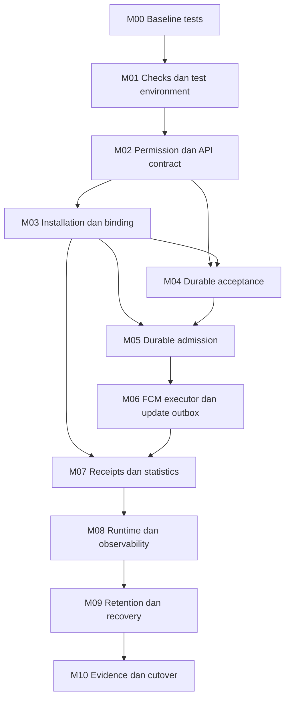

# Backend implementation milestones

Tanggal: 2026-11-02. Status: urutan kerja, bukan bukti implementasi/produksi.
Indeks: [production plan](production-readiness-plan.md).
Aturan bersama: [CR1–CR9 dan gate G1–G7](adr-01-11-consistency-review.md).

## Urutan dan dependensi

Nomor step 01–46 tetap mengikuti production plan; milestone di sini mengelompokkan
pekerjaan menurut dependensi, bukan mengharuskan semua keamanan menunggu pipeline.
M00 selesai pada 2026-11-02: mock diregenerasi, tests diselaraskan, seluruh unit
test dan build lulus. M01 step 18 selesai sebagai CI configuration/local checks;
hosted run belum diamati. Step 19 dependency environment/smoke juga selesai
lokal; M01 selesai pada batas bukti tersebut, bukan hosted integration atau
pipeline acceptance. M02–M10 belum
selesai. Pekerjaan yang memakai
keputusan belum settled harus mencatat proposed/test-only boundary dalam SPEC;
tidak boleh diaktifkan ke production dengan asumsi tersembunyi.

| Milestone | Dependensi | Potongan kerja berurutan dan output | Kriteria selesai | Step terkait |
| --- | --- | --- | --- | --- |
| M00 Baseline tests | Tidak ada gate eksternal | Regenerate mock dari interface; perbaiki fixture/assertion staff sesuai actor/password guards; perbaiki segment search/batch count assertions | Build dan seluruh unit test lulus tanpa skip/pelemahan guard; failure-path tests mencerminkan kontrak sekarang | 17 |
| M01 Checks dan test environment | M00 | Pisahkan commit CI format/build/test/vet/vulnerability; kemudian test PostgreSQL/migrations, Kafka topics dan provider simulasi yang terisolasi | Check dapat diulang dari clean checkout; readiness/cleanup deterministik; tak mengirim ke perangkat nyata atau membaca credential produksi | 18,19 |
| M02 API permission dan contract baseline | M01; keputusan G5 yang dipakai | SPEC permission matrix dan compatibility dahulu; deny-by-default mutation termasuk scheduling; safe errors/body limits/audit; dokumentasi API yang berubah | VIEWER tidak bisa mutate/send/schedule dari handler maupun service; actor inactive/forged access ditolak; public DTO/error tidak bocor | 20,31–33 |
| M03 Application scope dan immutable installation/binding | M02 baseline; ADR-12; G3/G5 untuk enrollment | M03a registry/principal/grants; M03b scoped schema/query/API dan legacy bridge gate; M03c installation/proof/JWT/binding; M03d generic mobile lifecycle/receipt contract. Lihat [rencana](../specs/m03a-application-scope-plan.md). | A/B isolation dan legacy route gate sebelum app kedua; race refresh/transfer/revocation menjaga immutable app/owner; generic client contract dan gate per-app | 20,22,30,32,33 |
| M04 Durable acceptance | M01,M02; shared schema/event contract M03 | SPEC gabungan acceptance/admission menetapkan deadline, epochs dan lock order; atomic key+claim+audit+send outbox; scheduler expiry/promotion; bounded publisher | Crash sebelum/sesudah commit atau broker ack tidak menghilangkan accepted work; same-key replay konsisten; expired schedule tidak dipublikasikan | 20,25,28 |
| M05 Durable admission | M03,M04 | Atomic snapshot/count/intent/fanout marker; serial consumer/commit; source-aware DLQ; requeue dan recovery QUEUED | Duplicate event tidak menambah audience/intent; partial transaction rollback utuh; DLQ DB failure memblokir advance offset; unsupported target/coverage hold eksplisit | 22,24,28 |
| M06 FCM execution dan delivery updates | M05; G2/G7 untuk konfigurasi/pengiriman nyata | SPEC provider/error mapping + attempt claim/lease/generation; bounded per-device executor, rate/breaker/retry/recovery; signer capability; result + versioned update outbox atomik | Failed/unknown attempt pulih dalam budget/deadline; stale generation/attempt tidak menulis; no orphan terminal work; simulated provider acceptance dan outbox crash windows teruji | 21,23,26–28 |
| M07 Receipt dan statistics | M03,M06; G3/G5 dan consumer contract G6 | Bearer + per-delivery capability; semantic dedup; early/late observations, read projection; snapshot denominator dan consumer version/epoch behavior | Cross-owner/forged receipt ditolak; early receipt tidak diregress worker; FAILED late observation tetap failure disposition; duplicated/reordered events tidak double-count | 26,29,30,33 |
| M08 Production runtime dan observability | M01–M07; G4 dan operator | Image/config validation, Kafka provisioning/ACL/hash mapping, resource bounds; drain/lifecycle; private health, logs/metrics, dashboards dan exercised alerts | Config drift fail closed; shutdown/rebalance aman; dependency outage tidak restart storm; deployment evidence membedakan single-host smoke dan multi-host failure | 34–36,39 |
| M09 Retention dan coordinated recovery | M07,M08; G6 | SPEC retention/erasure/FK/archive; bounded maintenance; off-host backup/WAL dan sealed restore; epoch/revocation/consumer reconciliation serta runbooks | Restore drill memenuhi agreed RPO/RTO; tidak otomatis resend uncertain work atau resurrect revoked identity; purge tidak menghapus pending/replay evidence | 37–39,43 |
| M10 Staging evidence dan cutover | M00–M09; G2–G7 settled untuk release | Android/iOS nyata; load/burst/soak 20k + headroom; dependency fault/security/restore review; pilot exclusive cohort; rollout dan OneSignal retirement | Numeric acceptance dan release gates lulus dengan evidence; operator/rollback jelas; tidak ada dual-send cohort; go/no-go eksplisit | 40–46 |

M06 dan M07 adalah acceptance gate bersama sebelum pilot: signer, verifier,
payload schema, update projection dan consumer compatibility tidak boleh
dikembangkan dengan kontrak yang saling berbeda. Implementasi M06 dapat diuji
terhadap provider simulasi ketika akses Firebase belum tersedia; itu bukan
bukti integrasi Firebase/APNs nyata. Pipeline baru tetap disabled/isolated
sampai milestone downstream yang dibutuhkan aman untuk aktivasi.

## Dependency graph

M04 bergantung pada kontrak identitas/schema M03; tidak perlu menunggu rollout
mobile selesai untuk menulis atau menguji transaksi terhadap fixture. Coverage
dan dispatch tetap held sampai enrollment/cutover evidence cukup. Instrumentasi
dasar dan fault tests ditambahkan bersama masing-masing fitur; M08 merakit dan
menguji operasi lengkap, bukan pertama kali menambahkan observability. M09
menambahkan maintenance setelah policy disetujui; retained identity/FK floors
sudah wajib di schema M03–M07 agar desain tidak menunggu recovery di akhir.

## SPEC M02a pertama

Role matrix dikonfirmasi pengguna pada 2026-11-02. [SPEC M02a](../specs/m02a-staff-operation-permissions.md)
dan [policy contract](../contracts/staff-permissions.json) sudah diimplementasikan
untuk notification/segment/member guards dan [diverifikasi lokal](m02a-verification.md). Ini menutup keputusan
role bisnis dari G5, bukan enrollment/session/operational policy lainnya.
Target API ada di [authorization contract](../api/authorization-api.md).

Shared current-authority checker/query, matrix tests, route/service wiring dan
real-DB/API negative tests M02a selesai. [M02b staff administration](m02b-verification.md)
juga implemented/local-verified pada 2026-11-03: tujuh route dan service memakai current DB authority. Atomic
authority/mutation/audit tetap mengikuti transaksi pemilik data M03/M04;
M02a tidak mengklaim revocation membatalkan operasi yang sudah diotorisasi.
[M02c audit redaction](m02c-verification.md) implemented/local-verified; skrip
historis dan runbook tersedia, tetapi cleanup produksi belum dijalankan.
[M02d request limits](m02d-verification.md) juga implemented/local-verified.
Session, rate limits, Content-Type/field policy, audit durability dan API/security baseline lain
tetap release controls yang terbuka. [Evaluasi baseline](m02-baseline-assessment.md)
menetapkan guard minimum siap lokal setelah [M02e staff JWT](m02e-verification.md);
M03 dapat mulai SPEC/implementasi terisolasi dengan gate integrasi eksplisit.
Prasyarat M03/M04 adalah guard baseline dan kontrak identitas
yang dipakainya, bukan menunggu semua transaksi future diimplementasikan di M02.

## Cara menyelesaikan satu milestone

1. Tulis satu SPEC kecil untuk slice berikutnya: input/output/error, migration
   dan compatibility, invariants, open gates serta acceptance cases. NEW path
   di `docs/specs/` ditentukan ketika slice dimulai; historical bigpickle bukan
   SPEC canonical. M00 menyelaraskan tests ke kontrak kode existing, tanpa API
   behavior baru atau companion SPEC fitur baru.
2. Implementasi dan test slice tersebut, termasuk failure window yang relevan.
   Simulasi tidak menggantikan real-device/multi-host/restore evidence.
3. Catat command, hasil dan batas buktinya; update API docs jika kontrak berubah,
   `code-review.md` jika finding ditutup, serta checklist production plan.
4. Commit kecil di `main` dengan Conventional Commits berscope; jangan mengemas
   tooling, rancangan dan perilaku runtime yang tidak terkait dalam satu commit.
   Commit rutin menjadi bagian penutupan slice; push/deploy mengikuti instruksi
   pengguna dan kesiapan lingkungan.

Tidak ada estimasi tanggal yang dijanjikan sebelum akses/gate/sizing diketahui.
Kriteria selesai milestone ini sengaja menjadi panduan untuk SPEC, bukan klaim
acceptance case seluruh sistem sudah ditulis atau ADR sudah accepted.

## Titik mulai berikutnya

M00/step 17 selesai dengan `go tool mockery`, `go test ./...` dan `go build ./...`
(memakai GOCACHE=/tmp/hello-go-review-cache di sandbox). Signature password,
auth fixtures, pgx not-found sentinel, filtered count dan batch membership count
sudah diselaraskan; tests juga memeriksa denial dan kegagalan repository.
Tidak ada perubahan perilaku service atau test yang di-skip.

M01 step 18/19 selesai sebagai [CI/local checks](ci-readiness.md) dan
[dependency smoke](integration-readiness.md). Step 20/M02 dimulai dengan SPEC
M02a dan M02b yang selesai implemented/local-verified; berikutnya slice M02
untuk API security baseline lain. M02c audit redaction dan M02d JSON body limits
sudah implemented/local-verified; historical cleanup tetap operator gate.
Evaluasi baseline dan M02e selesai secara scoped/local-verified. Berikutnya
[ADR-12 multi-aplikasi](../adr/adr-12-multi-application-isolation.md) dan
[rencana M03a–d](../specs/m03a-application-scope-plan.md): registry/scope dahulu,
baru identity/binding generik; kaiapps2 consumer pertama, bukan batas platform.
[Exact SPEC M03a](../specs/m03a-application-registry.md) dan proposed OpenAPI sudah
ditulis; berikutnya M03a.1 migration/query/sqlc, belum ada registry runtime.
M02 release controls belum dinyatakan selesai. Hosted execution,
production adapter/pipeline, real provider/device dan production infrastructure
belum dibuktikan oleh penyelesaian fondasi ini.
