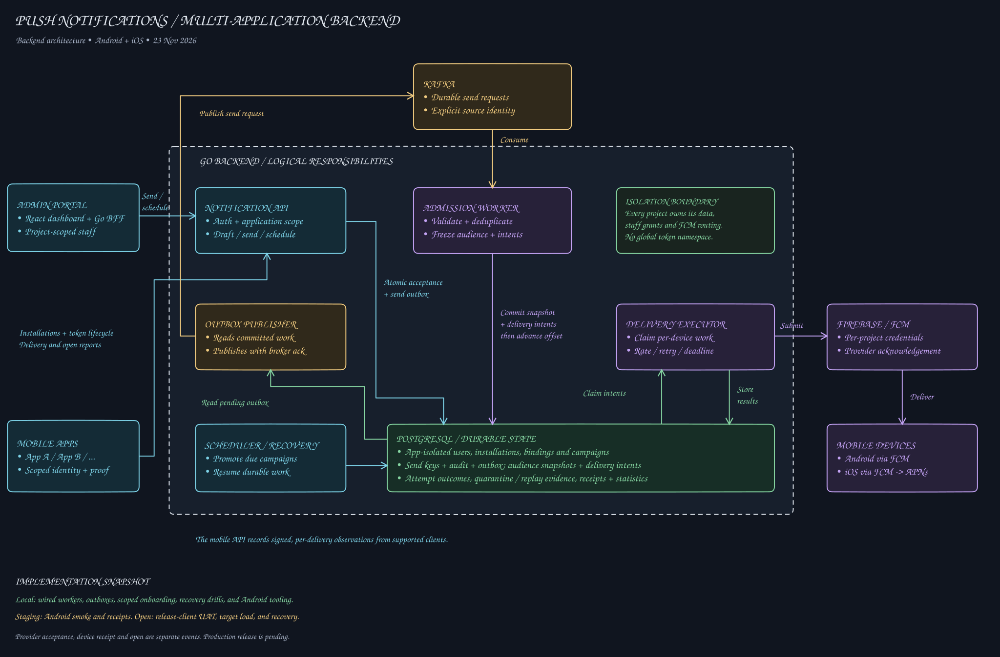

# Architecture diagrams

The [editable Excalidraw diagram](push-notification-system-design.excalidraw)
describes the multi-application push notification backend and its implementation
and acceptance status as of **2026-11-23**.



## Open and edit

Open the `.excalidraw` file in Excalidraw using **Open**, or drag it onto the
canvas. All shapes, text, and arrows are editable; no external assets are needed.
The adjacent SVG is a static preview of the same diagram. Both files use an explicit
dark canvas with matching high-contrast colors. After editing the
Excalidraw source, export an SVG with a background and replace the preview in
the same change. Keep labels and explanatory text in English.

## Scope and status

- The sketch layout groups backend responsibilities inside a dashed boundary;
  clients, Kafka and the delivery provider remain outside it.
- Colors identify responsibilities: teal for client/API/control flows, amber for
  broker publication, purple for admission/delivery, and green for durable state.
  Colors do not represent implementation completion.
- Named arrows describe target data flows. The implementation snapshot below
  the drawing separates local evidence from work still open. Boxes describe
  logical responsibilities rather than mandatory separate services.
- The API commits acceptance and outbox together in PostgreSQL. The publisher
  reads that outbox; there is no direct API-to-Kafka dual write.
- Admission persists the audience snapshot and delivery intents. The executor
  claims those durable intents from PostgreSQL rather than receiving an
  in-memory handoff from admission.
- PostgreSQL enforces durable idempotency and work ownership. The diagram does
  not assign correctness-critical locks or deduplication to Redis.
- The target routes both platforms through FCM, with APNs downstream for iOS.
  Provider acknowledgement does not establish device receipt or user engagement.
- The diagram summarizes receipt/update flows; it does not define a new Kafka
  topic, endpoint contract, deployment topology, or delivery guarantee.

The server, workers, scheduler, and scoped receipt ingestion are wired. The
staging test app demonstrated real Android delivery and receipt reporting for
one device. Release-client acceptance, production capacity, recovery, and
operational rollout remain open.

## Sources and maintenance

The interactive map uses [haydenschmitty/floorplan](https://github.com/haydenschmitty/floorplan).
Edit the checked-in [architecture source](../../floorplan/architecture.json)
for module summaries, flows, and environment boundaries. Update
[reviewed labels](../../floorplan/descriptions/hello-reviewed.json) when a mapped
file changes purpose. Refresh the map with Floorplan to regenerate
the local viewer at `floorplan/index.html`. The viewer, graph, and cache are
workstation files. Floorplan's scanner can miss dynamically registered dashboard
routes and Go route wrappers. Use the [API contracts](../contracts/README.md) and
the [dashboard router](../../web/dashboard/src/app/DashboardApp.tsx) for route
coverage.

Floorplan 0.11.0 can fail to lay out the map when an external node such as
**Mobile apps** has an outgoing connection to the API. Apply the
[viewer patch](floorplan-viewer-layout.patch) to a Floorplan 0.11.0 source
checkout before regenerating the viewer. From the Hello checkout, run:

```bash
git -C /path/to/floorplan apply "$PWD/docs/diagrams/floorplan-viewer-layout.patch"
```

To repair an existing unpatched viewer without regenerating it, apply the
patch to the generated HTML, recalculate its Content Security Policy hashes,
and reload the browser.

```bash
patch floorplan/index.html -i docs/diagrams/floorplan-viewer-layout.patch
node --input-type=module <<'JS'
import fs from 'node:fs';
import { withPolicy } from './floorplan/page-safety.mjs';
const path = 'floorplan/index.html';
fs.writeFileSync(path, withPolicy(fs.readFileSync(path, 'utf8'), 'local'));
JS
```

Use the [production readiness plan](../analysis/production-readiness-plan.md)
and [implementation milestones](../analysis/implementation-milestones.md) for
current progress and release gates. Architectural details are maintained in:

- [Application isolation: ADR-12](../adr/adr-12-multi-application-isolation.md).
- [Durable acceptance](../specs/m04-durable-acceptance.md) and
  [outbox publication](../specs/m04-outbox-dispatch.md).
- [Atomic audience preparation](../specs/m05-durable-preparation.md),
  [QUEUED recovery](../specs/m05-queued-recovery.md), and
  [operator reprocessing](../specs/m05-operator-reprocessing.md).
- [Provider selection](../adr/adr-04-provider-selection.md) and
  [receipt ingestion](../adr/adr-05-receipt-ingestion.md).

Update the diagram's date and status labels alongside meaningful architecture or
implementation changes. This is a replacement overview of the initial design,
not evidence that every depicted path is deployed.
