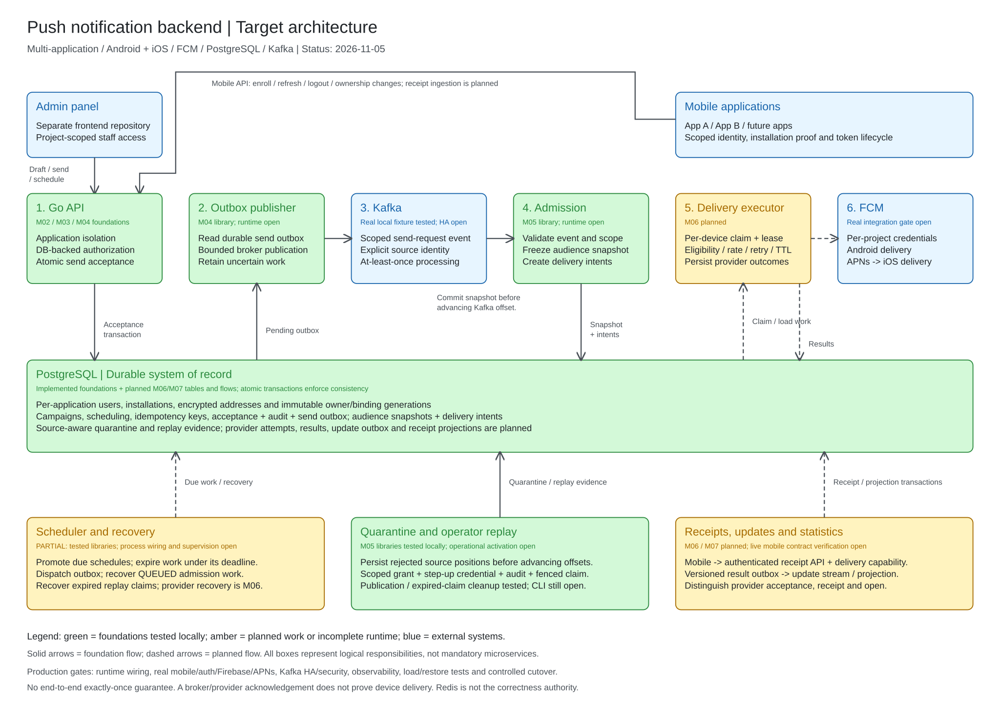

# Architecture diagrams

The [editable Excalidraw diagram](push-notification-system-design.excalidraw)
describes the target multi-application push notification backend and its local
implementation status as of **2026-11-05**.

## Open and edit

Open the `.excalidraw` file in Excalidraw using **Open**, or drag it onto the
canvas. All shapes, text, and arrows are editable; no external assets are needed.
The adjacent SVG is a static preview of the same diagram. After editing the
Excalidraw source, export an SVG with a background and replace the preview in
the same change. Keep labels and explanatory text in English.

## Scope and status

- Green identifies foundations implemented and tested locally. Labels explicitly
  identify outstanding runtime or operational work; green does not mean a
  complete milestone or production readiness.
- Amber identifies planned work or incomplete runtime composition.
- Blue identifies external clients, messaging infrastructure, or providers.
- Solid arrows show foundation flows; dashed arrows show planned flows. Boxes
  describe logical responsibilities, not a requirement for separate services.
- The API commits acceptance and outbox together in PostgreSQL. The publisher
  reads that outbox; there is no direct API-to-Kafka dual write.
- Admission persists the audience snapshot and delivery intents. The executor
  claims those durable intents from PostgreSQL rather than receiving an
  in-memory handoff from admission.
- PostgreSQL enforces durable idempotency and work ownership. The diagram does
  not assign correctness-critical locks or deduplication to Redis.
- The target routes both platforms through FCM, with APNs downstream for iOS.
  Provider acknowledgement does not establish device receipt or user engagement.
- The diagram summarizes receipt/update flows; it does not define a new Kafka
  topic, endpoint contract, deployment topology, or delivery guarantee.

The modern worker and scheduler entry points remain intentionally unwired. FCM
execution, receipt projections, real client/provider verification, infrastructure
hardening, and production acceptance remain open. Library fixture tests do not
establish end-to-end delivery or production readiness.

## Sources and maintenance

Use the [production readiness plan](../analysis/production-readiness-plan.md)
and [implementation milestones](../analysis/implementation-milestones.md) for
current progress and release gates. Architectural details are maintained in:

- [Application isolation: ADR-12](../adr/adr-12-multi-application-isolation.md).
- [Durable acceptance](../specs/m04-durable-acceptance.md) and
  [outbox publication](../specs/m04-outbox-dispatch.md).
- [Atomic audience preparation](../specs/m05-durable-preparation.md),
  [QUEUED recovery](../specs/m05-queued-recovery.md), and
  [operator reprocessing](../specs/m05-operator-reprocessing.md).
- [Provider selection](../adr/adr-04-provider-selection.md) and
  [receipt ingestion](../adr/adr-05-receipt-ingestion.md).

Update the diagram's date and status labels alongside meaningful architecture or
implementation changes. This is a replacement overview of the initial design,
not evidence that every depicted path is deployed.
